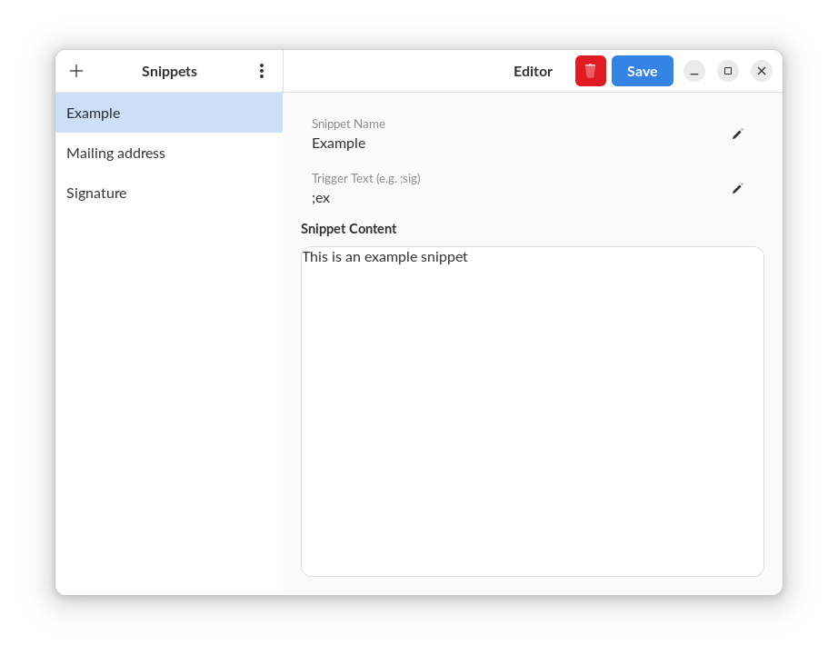
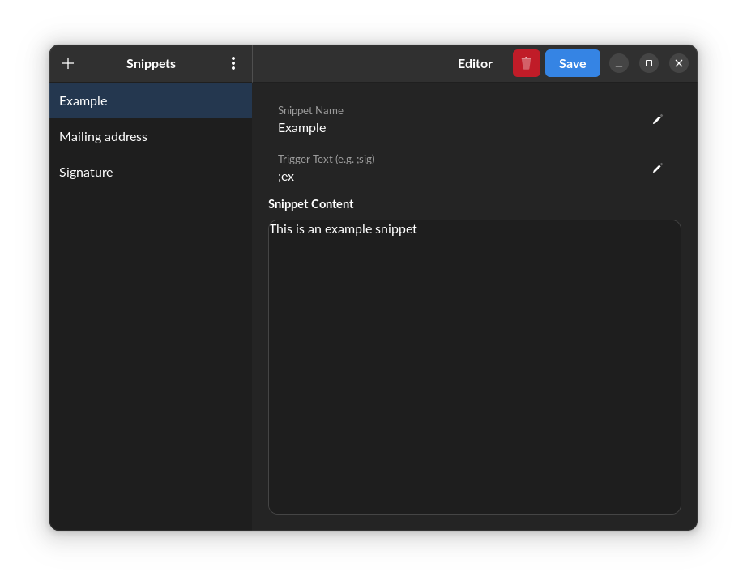
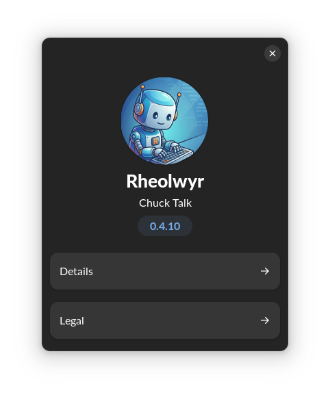
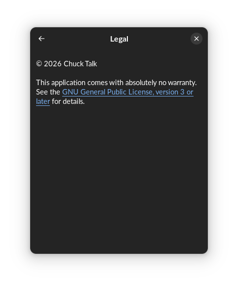

#  Rheolwyr

Linux text expander.
Version 0.5.18
Rheolwyr ("Manager" in Welsh), pronounced "Hre-aw-lur", is a Linux-native text snippet manager designed for Pop!_OS Cosmic and GNOME on Wayland.

> **Security notice:** Rheolwyr reads your keystrokes globally to detect
> triggers. On Wayland this requires adding your user to the `input` group,
> which grants that account the ability to read **every keystroke from every
> application**, system-wide and permanently. Rheolwyr does not record or log
> keystrokes, but the group membership is a lasting privilege grant. Please read
> [SECURITY.md](SECURITY.md) — including the least-privilege alternatives —
> before enabling expansion.

**When triggers expand:**

- Triggers that start with a **symbol**, such as `;sig`, expand as soon as you
  finish typing them.
- Triggers that start with a **letter or number**, such as `addr`, expand only
  when typed as a whole word followed by **Space**. Typing `address` never fires
  `addr`. (Tab doesn't complete a trigger, because in forms it moves to another
  field.)
- If one symbol trigger is the start of another (`;s` and `;sig`), typing
  `;sig` expands `;sig`; `;s` expands at the first key that isn't part of
  `;sig`, and that key is kept.

## Features

- **Text Expansion**: Expands your triggers into snippets in almost any application.
- **Split-View Editor**: Manage and edit snippets easily.
- **Import/Export**: Back up and restore snippets as JSON.
- **Theme persistence**: Remembers your preferred theme.
- **Wayland & X11 Support**: Works on GNOME and Pop!_OS COSMIC, on Wayland or X11.

Rheolwyr expands snippets **only while its window is open** (minimized is
fine). Closing the window quits it. There is no system-tray or background mode:
for an app that reads your keystrokes, an open window is a clear sign that it is
running.

## Screenshots

### Main Interface
 




## Installation

The recommended way to install Rheolwyr is via the native `.deb` package provided in the GitHub Releases. It installs Rheolwyr system-wide with the udev rule and kernel module it needs for typing on Wayland. It does **not** add you to the `input` group; that stays your choice (see *Enabling Text Expansion* below).

1. Download the latest `rheolwyr_*_all.deb` package from the [Releases page](https://github.com/TaliskerMan/Rheolwyr/releases).
2. Install the package using `apt` (this will automatically install required dependencies):
   ```bash
   sudo apt install ./rheolwyr_*_all.deb
   ```

### Building from Source (Development)

1. Install system dependencies:

   ```bash
   sudo apt install libcairo2-dev libgirepository1.0-dev pkg-config python3-dev xclip wl-clipboard
   ```

2. Install python dependencies:

   ```bash
   pip install -r requirements.txt
   ```

3. Run the application:

   ```bash
   python -m rheolwyr.main
   ```

## Tech Stack

- Python 3
- GTK4 + Libadwaita
- SQLite

## Packaging

### Debian / Ubuntu

Build using `dpkg-buildpackage` (signing enabled by default):

```bash
dpkg-buildpackage
```

## Setup & Troubleshooting

### Enabling Text Expansion (Wayland/Input)

For text expansion to work, especially on Wayland, your user needs permission to monitor input devices and inject keys. The package installs a udev rule for `uinput`, but you must manually add your user to the required groups.

1.  **Add your user to the `input` and `uinput` groups**:

    ```bash
    sudo usermod -aG input,uinput $USER
    ```

2.  **Log out and log back in**:
    Group changes **will not take effect** until you log out of your desktop session and log back in (or reboot).

### Common Issues

-   **"Snippet not expanding"**:
    -   Verify you are in the groups: run `groups` and look for `input` and `uinput`.
    -   Ensure Rheolwyr's window is open (minimized is fine); closing it quits Rheolwyr.
    -   Letter triggers such as `brb` need a **Space** after them.

## License

GPLv3
